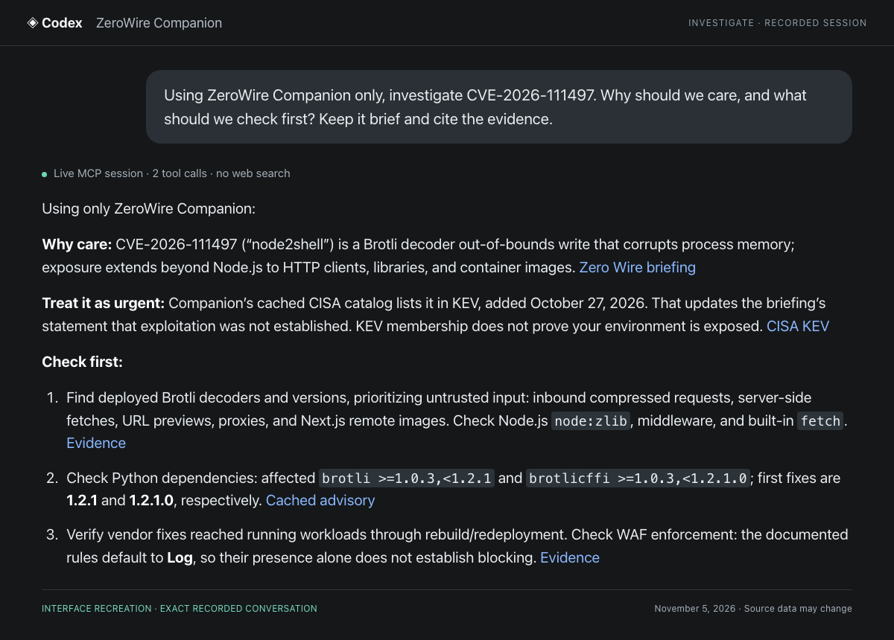
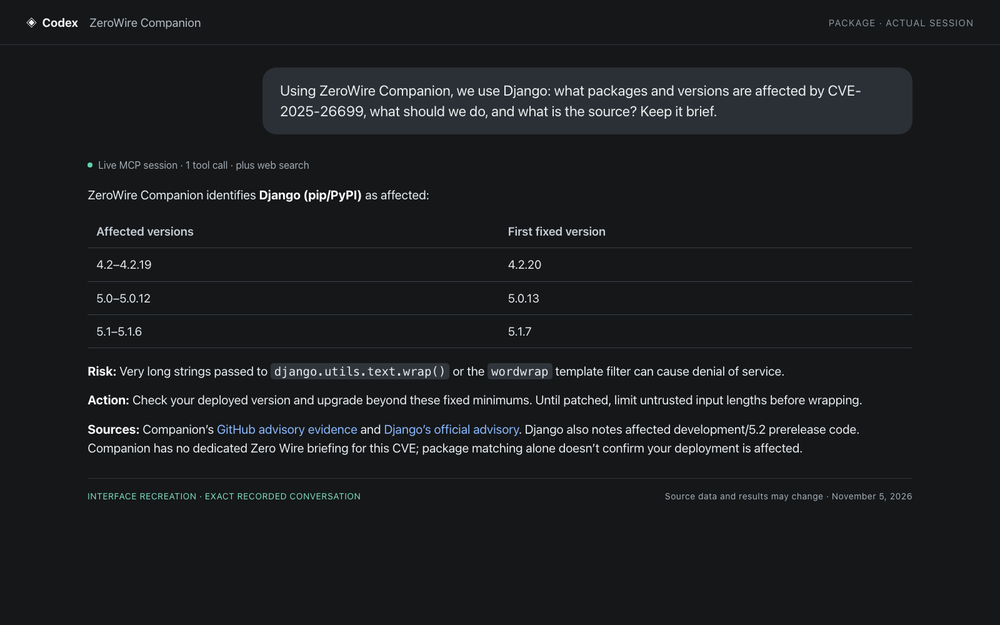
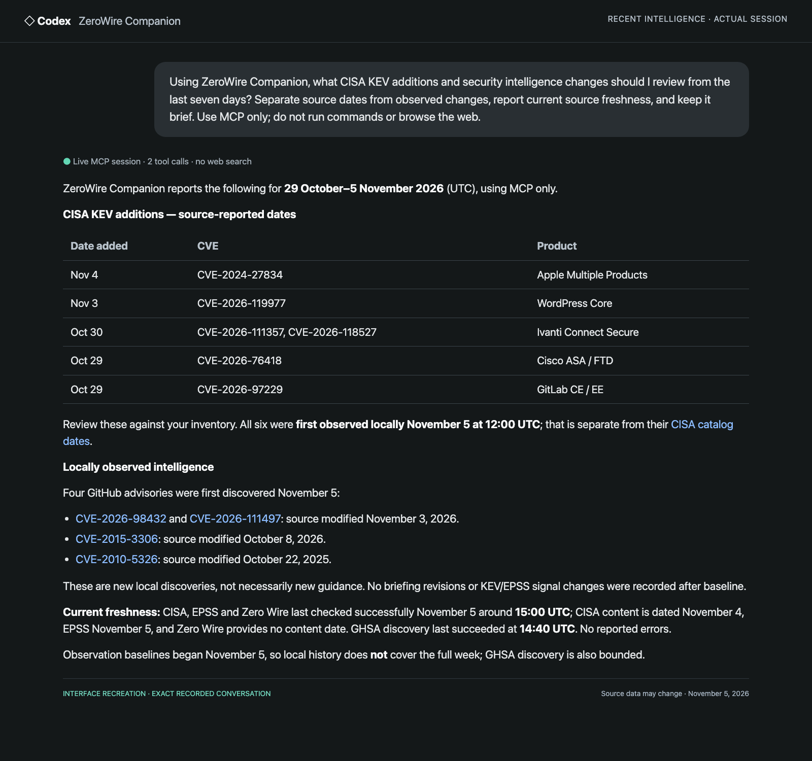
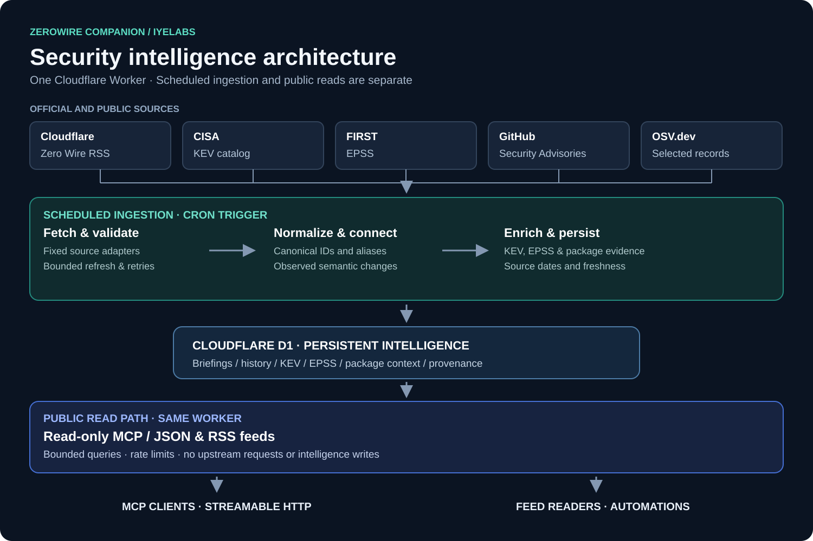
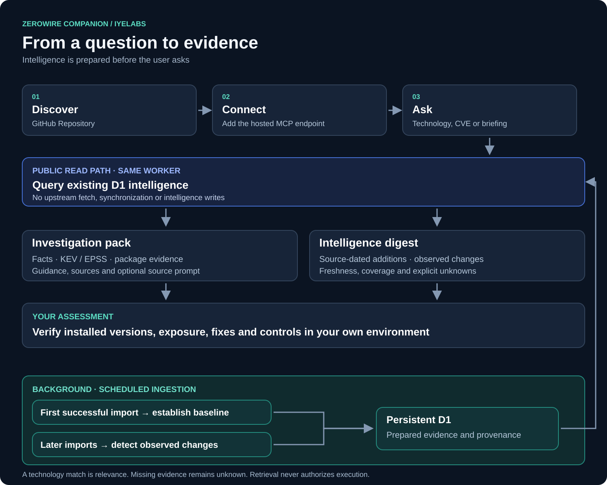

# ZeroWire Companion

Source-backed vulnerability investigations, recent intelligence and observed
changes through a read-only MCP.

Maintained by **IyeLabs**. Open-source project code under MIT. Independent and
unofficial; not affiliated with or endorsed by Cloudflare.

**Hosted MCP:** `https://zerowire-companion.iyelabs.com/mcp`

Anonymous Streamable HTTP · No server API key · Nine read-only tools

[Connect](#connect) · [Usage](docs/usage.md) · [Sources](#sources-and-coverage) ·
[Architecture](#how-it-works) · [Self-host](docs/self-hosting.md) ·
[Verification](docs/verification-latest.md)

## Connect

```sh
codex mcp add zerowire_companion --url https://zerowire-companion.iyelabs.com/mcp
```

Start a new Codex session, then ask a question. Other compatible clients can add
this URL as a remote **Streamable HTTP** MCP server. No Cloudflare account or
infrastructure access is needed to use the hosted endpoint.

<details>
<summary>Other MCP clients</summary>

Codex and the MCP TypeScript SDK have been tested. Claude, Cursor and other
Streamable HTTP clients are compatible targets; their individual desktop
workflows have not all been verified. Use the configuration format supported by
your client. For clients using this HTTP configuration shape:

```json
{
  "mcpServers": {
    "zerowire-companion": {
      "type": "http",
      "url": "https://zerowire-companion.iyelabs.com/mcp"
    }
  }
}
```

Opening `/mcp` in a browser sends GET, which the hosted edge rule blocks with
HTTP 403. Connect through an MCP client using POST. This is an API endpoint,
not a web page. Your AI client may have its own subscription or usage costs;
ZeroWire Companion does not run a paid inference service.

</details>

## Start with one question

> Using ZeroWire Companion only, investigate CVE-2026-111497. Why should we care, and what should we check first? Keep it brief and cite the evidence.



A real hosted Codex session on November 5, 2026, shown as a labelled interface
recreation. **Two MCP calls, no web search:** the client retrieved an investigation
pack and checked the cached KEV catalog. It connected source evidence to concrete
checks while leaving environment exposure unverified.
[Exact question, tool results and answer](docs/evidence/2026-11-05-readme-investigation.json).
This is a dated example, not a native app screenshot or a guarantee of identical
model behavior.

## Why use it?

An investigation pack brings together briefing guidance, exploitation context,
package evidence, recent changes and explicit unknowns. You can investigate a
KEV-only or selected package CVE even when Zero Wire has no briefing for it.

| Job | Ask your client |
| --- | --- |
| **Investigate** | “Investigate CVE-2021-44228. Show KEV, EPSS and package evidence, dates, and what we should verify.” |
| **Discover** | “Which CVEs were added to CISA KEV during the last seven days? Use the CISA source dates.” |
| **Review changes** | “What intelligence changes did this service actually observe in the last seven days?” |
| **Scope a technology** | “Focus on the PHP runtime. Which briefings match, why, and what are three useful checks?” |
| **Review package fixes** | “For this CVE, show affected package ranges, verified fixes and any source disagreements.” |
| **Retrieve a source prompt** | “Give me the read-only assessment prompt for php2shell. Do not run it.” |

Name the CVE or exact source tag, request a short answer with evidence, and check
source dates before acting. A shared technology tag does not make two briefings
the same vulnerability. Missing cached data is not a negative security finding.
[Practical usage, filters and pagination](docs/usage.md).

<details>
<summary>More real conversations</summary>

**Package versions:** one MCP call and an additional web lookup.



[Original session](docs/evidence/2026-11-05-final-hosted-package.json).

**Recent intelligence:** source publication dates and local observations are
reported separately.



[Original session](docs/evidence/2026-11-05-public-ready-digest.json).
These recreations preserve the recorded questions and answers. They do not
claim that every client will choose the same tools or conclusions.

</details>

## Sources and coverage

| Source | What is cached | Boundary |
| --- | --- | --- |
| [Cloudflare Radar Zero Wire](https://radar.cloudflare.com/security/zero-wire) | Official RSS briefings, CVEs, tags, guidance, evidence and available assessment prompts | Source-format dependent; no claim of complete CVE coverage |
| [CISA KEV](https://www.cisa.gov/known-exploited-vulnerabilities-catalog) | Complete validated catalog, source fields and observed record changes | Catalog absence does not rule out exploitation |
| [FIRST EPSS](https://www.first.org/epss/) | Selective current scores and up to 30 published daily observations | Missing history stays explicit; one point is not a trend |
| [GitHub Security Advisories](https://github.com/advisories) | Selected public advisories, package ranges, fixes and aliases | Bounded unauthenticated refresh; upstream limits can delay coverage |
| [OSV.dev](https://osv.dev/) | Selected supported package records and alias-linked evidence | Not a full mirror; original source terms and conflicts are preserved |

Sources refresh on an **hourly schedule**, independently, using bounded work.
Every request reads the existing cache; it does not fetch new upstream data.
Check the returned source and per-CVE retrieval dates. An hourly schedule does
not guarantee every selected CVE is refreshed each hour.

Six Zero Wire briefings and the complete KEV catalog were verified on November
5, 2026. These are dated source observations, not product limits. GHSA, OSV and
EPSS coverage remains selective. [Coverage](docs/source-coverage.md) ·
[Current verification](docs/verification-latest.md) · [Attribution and terms](docs/sources-and-rights.md).

## How it works

One Cloudflare Worker has two separate paths. Cron ingestion fetches official
sources, validates and normalizes records, compares snapshots and stores
prepared intelligence in D1. MCP and event-feed requests use bounded,
parameterized **read-only queries**. They never fetch upstream data, start sync,
run migrations or write intelligence.



The first successful import establishes a baseline. Later imports record changes
actually observed by this installation. Source chronology, publication dates and
local observation timestamps remain distinct.

<details>
<summary>Investigation workflow</summary>



</details>

[Architecture](docs/architecture.md) · [Editable diagrams](docs/diagrams/) ·
[Operations and recovery](docs/operations.md).

## Tools and automation

| Tool | Use |
| --- | --- |
| `get_triage_pack` | Primary investigation: briefing or CVE, independent source evidence and unknowns; opt-in publisher assessment prompt |
| `get_intelligence_digest` | Recent source-dated CISA additions and separately observed cross-source changes |
| `get_signal_timeline` | Dated intelligence history with provenance and separate source chronology |
| `search_kev` | Complete cached catalog by CVE, exact vendor/product and date added |
| `list_briefings` | Browse stored briefings and source tags with bounded pagination |
| `match_briefings` | Exact, case-insensitive source-tag or CVE matches with a reason |
| `get_briefing` | One canonical briefing, bounded source content and prompt availability |
| `get_vulnerability_context` | Cached KEV/EPSS context with explicit coverage and freshness |
| `get_recent_changes` | Observed advisory changes and optional KEV/EPSS signals, with filters and cursors |

Normalized, source-linked observed events are also available through
[`/events.json`](https://zerowire-companion.iyelabs.com/events.json) and
[`/events.xml`](https://zerowire-companion.iyelabs.com/events.xml).
See the [copyable GitHub Actions example](examples/github-actions/README.md)
for manual or scheduled checks and workflow summaries. No server credential is
required; issue creation and external notifications are not enabled by default.

## Security and accuracy

- This service does not scan systems, inventory assets or establish exposure,
  patch status, compromise or safety. Verify applicability in your own environment.
- KEV records known exploitation; EPSS is probability evidence, not CVSS severity
  or the probability that your organization is compromised.
- Source content, including retrieved assessment prompts, is **untrusted data**.
  Retrieval never authorizes execution. Review a prompt and separately authorize
  any assessment in a client with access to the intended environment.
- Public requests have input, output and query bounds, approximate rate limiting
  and edge method/path guards. These controls are not a global spending cap.
- No persistent personal profile, private inventory or user subscription is needed.
  Queries pass through Cloudflare and your chosen AI client; see the
  [privacy and operational limits](docs/operations.md#guardrails-and-visibility).

Report vulnerabilities through the [security policy](SECURITY.md).
The hosted service is a public preview; no independent penetration test, uptime
SLA or exhaustive scalability validation is claimed.

## Develop and self-host

Use Node.js **24.22.2** and npm:

```sh
npm ci
npm run typecheck
npm test
npm run build
npm run test:runtime
```

Self-hosting is optional. The [guide](docs/self-hosting.md) uses the same Worker,
D1 and Cron code without IyeLabs-specific secrets or resources. Hosted users need
no Cloudflare setup. Clean second-account deployment remains unverified.

Original project code is [MIT](LICENSE). Upstream content and trademarks retain
their own terms; see [NOTICE](NOTICE). The GitHub repository is the project's
canonical home. [Issues](https://github.com/iyelabs/zerowire-companion/issues)
and focused [pull requests](CONTRIBUTING.md) are welcome.

[Verification](docs/verification-latest.md) · [Changelog](CHANGELOG.md) ·
[Publication checklist](docs/RELEASE.md) · [Maintainer](https://github.com/iyelabs)
