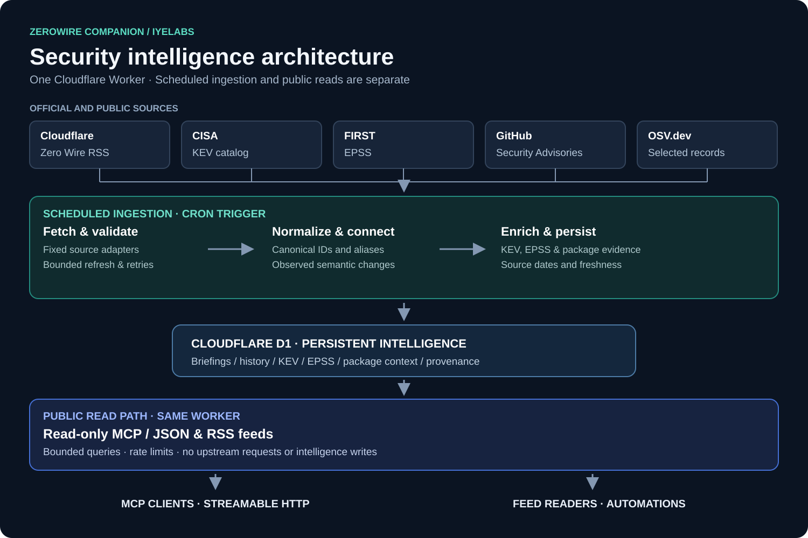

# Architecture

ZeroWire Companion runs as one Cloudflare Worker with two separate execution
paths and a persistent D1 database. The IyeLabs deployment is a hosted public preview at
`https://zerowire-companion.iyelabs.com/mcp`. This document describes the
repository implementation; consult [verification status](verification-latest.md)
for the verification commands and recorded usage examples.

## Scheduled ingestion

`src/index.ts` dispatches scheduled events to `src/ingestion/scheduled.ts`.
When ingestion is enabled, the handler obtains an expiring D1 lease, fetches the
fixed official RSS URL, validates and normalizes the feed, and atomically stores
snapshots and observed changes. Transactional fencing prevents an expired lease
owner from persisting over a successor. The first successful sync is a baseline;
it does not manufacture prior events. A normalizer version change is not
reported as a source change.

RSS failure does not prevent enrichment refresh of already tracked CVEs. The
ingestion path stages the complete CISA KEV catalog in bounded batches and
enriches tracked CVEs with FIRST EPSS history and selected GHSA/OSV advisory
evidence. Each source has separate progress and failure state. EPSS series,
GHSA and OSV refreshes are intentionally selective and do not mirror their
complete catalogs. Every new KEV catalog generation, the initial one and each later
CISA update, is staged at 250 records per hourly run. A catalog of about 1,800
records therefore takes about eight runs to publish, and the last complete catalog
stays published until then. KEV context for briefing CVEs is refreshed from each
download in bounded batches, without waiting for staging. Upstream redirects are not followed; bodies and request times are bounded.
An upstream failure preserves the last successful data.

## Read-only MCP

The `fetch()` handler uses the MCP SDK with stateless Streamable HTTP and
exposes bounded JSON/RSS event feeds. It receives
a query adapter exposing fixed, parameterized SELECT operations, not the raw D1
binding. Requests do not start an upstream fetch, synchronization, migration or
D1 write. The path applies rate limiting, origin and method checks, request and
response limits, and privacy-conscious logging. Cloudflare rate limiting is
approximate per location, not a global budget or a complete abuse strategy.

Code capability boundaries and tests enforce the separation; Cloudflare does not
provide separate database permissions for the two handlers within this Worker.
Source text and links are untrusted data. Evidence URLs are returned as data and
are not fetched by the public path.

## Persistent state

D1 holds canonical briefing identities, immutable observed snapshots, CVE/tag
relations, observed change events, source freshness and per-CVE enrichment.
Additive migrations preserve dated observations, source-backed transitions,
full KEV catalog generations, selected EPSS history and package context, plus
observed historical briefing/CVE associations.
Hashes are not globally unique: A → B → A is represented as two changes.
Migration files are applied separately from request and scheduled handling. The deployable configuration does not embed an account ID, custom domain or
deployment secret; documentation names the optional maintained endpoint.

Normalizer version 3 compares normalized section text and HTTPS references,
including unknown sections, instead of raw HTML. Unknown textual changes are
labelled unclassified for review, rather than asserted to be material security
changes. Whitespace, markup and the recognized last-checked date do not create
material events. Source metadata-only
changes can create snapshots without material events. The previous and current raw snapshots are compared with the same normalizer
during an upgrade; a parser-only change creates no upstream event, while a real
source change remains observable. If old fields are insufficient to compare,
ingestion fails closed and preserves the last known state. Missing sections are unknown, not evidence of absence. The
extractor depends on source heading format; inspect the original briefing when
making a security decision. The expanded tools and feeds are deployed to the hosted preview; the complete KEV
baseline was verified against the official catalog on November 5, 2026.

## Limits and release

The Worker uses fixed resource and response bounds and structured logs. The
hosted deployment has recorded Cron, hostname, nine-tool, feed and real-client
checks. The maintainer has accepted the intended Zero Wire source usage;
attribution and upstream terms remain separate from the MIT code license.
A second-account deployment, independent penetration test, representative
endurance test and destructive restore remain unperformed, disclosed limits.
They are not claimed as passing checks. See [current verification](verification-latest.md),
[operations](operations.md) and the [release checklist](RELEASE.md).
